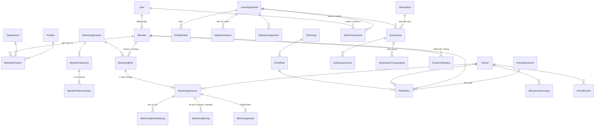

# Thiết kế cơ sở dữ liệu HLC LMS (PostgreSQL)

Tài liệu đi kèm:

| File | Nội dung |
|---|---|
| [schema.sql](schema.sql) | DDL đầy đủ: 30 bảng, ràng buộc, index, hàm tính trạng thái mentoring |
| [seed.sql](seed.sql) | Danh mục ban đầu: ban, chức vụ, loại điểm, rule điểm mentoring và quỹ, 3 module học tập |
| [queries.sql](queries.sql) | Các truy vấn "Tính lại" điểm của một tháng (rule engine) |

Cả 3 file đã được chạy thử trên PostgreSQL 16 với kịch bản tháng 10/2026. Kết quả kiểm thử nằm ở mục 9.

### Thay đổi theo yêu cầu cập nhật ngày 20/10 (`TONG_QUAN_HE_THONG.md`)

| Yêu cầu | Thay đổi trong thiết kế |
|---|---|
| 2 loại điểm: điểm phụ cấp và điểm chấm bài (thang 100) | Điểm chấm bài nằm ở `Submission.totalScore` / `SubmissionScore`, thang `LearningModule.maxScore` mặc định **100**. Không bao giờ đi vào sổ điểm phụ cấp `PointEntry`. |
| Chia quyền: admin tổng, admin 1 module, admin nhiều module | Bảng mới **`AdminPermission`** (mục 7). Bỏ `LearningModule.reviewerDepartmentId` và `Position.canReview`. |
| Mã module học tập tự sinh | `LearningModule.code` do service sinh (`LM-0001`, `LM-0002`, …), client không gửi và không sửa được. |
| Phụ cấp chức vụ chỉnh tay, tạm ẩn | Rule chức vụ vẫn tắt; admin cộng tay bằng `PointAdjustment` (loại điểm `POSITION`). |
| Đóng quỹ 150k/tháng → +2 điểm (mentee) | `FundContribution` cho **nhiều lần nộp / tháng**, bắt buộc số tiền. Rule mới `FUND_MONTHLY_FULL`: tổng tiền đã duyệt trong tháng ≥ 150.000đ thì +2. |
| Mentor nộp quỹ theo nhóm do mentee quản trị | **Để sau** theo ghi chú. `FundContribution` dùng chung cho mọi thành viên nên mở rộng được. |
| Bỏ PDF, chỉ xuất Excel/CSV | `PeriodExport.exportType` chỉ còn `ALLOWANCE_XLSX`, `ALLOWANCE_CSV`, `MONTHLY_REPORT_XLSX`. |

---

## 1. Quy ước

Các quy ước này khớp với base NestJS/Sequelize hiện có trong `backend/`:

- **Khóa chính** là `"_id" VARCHAR(24)`, giá trị là chuỗi ObjectId do ứng dụng sinh (decorator `@StrObjectId()`). DB không tự sinh id.
- **Tên bảng** trùng hằng `Entity` (PascalCase, ví dụ `"MentoringSession"`). **Tên cột** viết camelCase giống field của entity, nên không cần map tên.
- Mọi bảng có `"createdAt"`, `"updatedAt"` (`TIMESTAMPTZ`).
- **Enum** lưu bằng `VARCHAR` + `CHECK`, không dùng kiểu `ENUM` của Postgres, vì kiểu đó khó thêm hoặc bớt giá trị. Trong model Sequelize dùng `DataType.STRING` + `validate: { isIn }`.
- Mốc thời gian dùng `TIMESTAMPTZ`; ngày lịch (ngày sinh, ngày đóng quỹ, hiệu lực chức vụ) dùng `DATE`.
- **Mọi quy tắc "ngày X trong tháng" phải quy đổi sang giờ `Asia/Ho_Chi_Minh`.** Ví dụ: 06:30 ngày 14 giờ VN vẫn là ngày 13 nếu tính theo UTC.
- Bảng `"User"` (tài khoản đăng nhập) thuộc base. Schema này chỉ tham chiếu tới nó.

---

## 2. Tổng quan: 7 nhóm bảng



| Nhóm | Bảng |
|---|---|
| **A. Nền tảng** | `Member`, `Department`, `Position`, `MemberPosition`, `Period`, `Attachment` |
| **B. Mentoring** | `MentoringQuarter`, `MentorPreference`, `MentorPreferenceItem`, `MentoringPair`, `MentoringSession`, `MentoringScheduleLog`, `MentoringRecap`, `MentoringAward` |
| **C. Module học tập động** | `LearningModule`, `ModuleField`, `ModuleCriterion`, `ModuleAssignment`, `Submission`, `SubmissionUniqueValue`, `SubmissionScore`, `LibraryItem` |
| **D. HLC Fund** | `FundContribution` |
| **E. Điểm và phụ cấp** | `PointType`, `PointRule`, `PointEntry`, `PointAdjustment`, `AllowanceSummary`, `PeriodExport` |
| **F. Phân quyền admin** | `AdminPermission` |
| **G. Hàm** | `mentoring_session_status(p_now)`: trạng thái recap của từng người và của cặp tại thời điểm `p_now` |

Nguyên tắc xuyên suốt: **mỗi hoạt động có đúng một bản ghi gốc**. Điểm là các dòng `PointEntry` **trỏ ngược** về bản ghi gốc qua `sourceType` + `sourceId`, không bao giờ nhập lại số liệu.

---

## 3. Nhóm A: Nền tảng

| Bảng | Vai trò | Ràng buộc chính |
|---|---|---|
| `Member` | Hồ sơ mentee/mentor (import từ file hiện có). Có thể chưa có tài khoản (`userId` NULL). | `memberCode` dạng `HLC-MTE-xxxxx` hoặc `HLC-MTO-xxxxx`, **prefix phải khớp `memberType`** |
| `Department` | Ban, nhóm. `type` = `ACADEMIC` (Ban học tập), `FUND`, `MENTORING`, `GROUP`. Nhóm con dùng `parentId`. | `code` unique |
| `Position` | Danh mục chức vụ: trưởng ban, phó ban, leader, phó leader. | `code` unique |
| `MemberPosition` | Ai giữ chức vụ gì, ở ban nào, **từ ngày nào đến ngày nào**. Nguồn của điểm phụ cấp chức vụ (tính năng đang tạm ẩn). | `endDate >= startDate`, NULL = đang giữ |
| `Period` | **Kỳ tháng**: đơn vị tính điểm và chi trả. Gồm `pointRate`, `baseAllowance`, `payoutDate` (mùng 10 tháng sau). | `(year, month)` unique; trạng thái `OPEN → CALCULATING → REVIEWING → LOCKED → EXPORTED → PAID` |
| `Attachment` | Ảnh/file dùng chung cho recap, bài nộp, minh chứng quỹ, thư viện. Luồng: upload qua `POST /file` (bảng `File` của base, lưu trong DB hoặc MinIO) → tạo `Attachment` với `fileId` + `url`. | index `(ownerType, ownerId)`; `fileId` → `File` (xóa file thì về NULL) |

Quyền duyệt và quản trị không gắn với chức vụ nữa mà nằm ở bảng `AdminPermission` (mục 7).

---

## 4. Nhóm B: Mentoring

### 4.1 Mô hình: Quý → Cặp → Buổi theo tháng

```
MentoringQuarter (2026Q4)
 └── MentoringPair (mentor + mentee, cả quý)          ← admin ghép 1 lần cho cả quý
      ├── MentoringSession tháng 10  (lịch + hạn recap) ── MentoringRecap MENTOR / MENTEE
      ├── MentoringSession tháng 11
      └── MentoringSession tháng 12
```

So với hệ thống cũ (cặp được nhân bản theo tháng, lịch tách riêng): **cặp được lưu 1 lần cho cả quý, còn "lịch đã chốt" là các cột trên `MentoringSession`**, vì mỗi cặp mỗi tháng chỉ có 1 buổi. Cách này bỏ được dữ liệu lặp và gom các quy tắc vào một chỗ.

### 4.2 Bảng và ràng buộc

| Bảng | Ràng buộc DB |
|---|---|
| `MentoringQuarter` | `(year, quarter)` unique. Mốc `preferenceOpenAt` (ngày 5) ≤ `pairingOpenAt` (ngày 10) ≤ `visibleAt` (ngày 25). |
| `MentorPreference` + `Item` | 1 nguyện vọng / mentee / quý; mentor không trùng; thứ tự ưu tiên không trùng. Số lượng 3–10 kiểm tra ở service. |
| `MentoringPair` | **1 mentee chỉ có 1 cặp `ACTIVE` / quý** (partial unique index); mentor ≠ mentee. Đổi mentor giữa quý thì cặp cũ chuyển `ENDED`, tạo cặp mới cho các tháng còn lại; các buổi đã diễn ra vẫn giữ nguyên. |
| `MentoringSession` | **1 buổi / cặp / tháng**. Có giờ bắt đầu thì bắt buộc có giờ kết thúc > giờ bắt đầu, `firstScheduledStartAt` và `recapDeadlineAt`. |
| `MentoringScheduleLog` | Mỗi lần gửi, sửa, admin override hay hủy lịch đều ghi lại giờ cũ và giờ mới. |
| `MentoringRecap` | **Mỗi buổi tối đa 1 recap của mentor và 1 của mentee.** Gồm `firstSubmittedAt` (lần nộp đầu), `lastSubmittedAt` (lần sửa cuối), `isLate`. |
| `MentoringAward` | Mỗi tháng chỉ có 1 cặp mỗi hạng; 1 buổi chỉ nhận 1 giải. `rankingBasis` lưu lại căn cứ xếp hạng. |

### 4.3 Quy tắc nghiệp vụ được thể hiện thế nào

| Quy tắc | Cách làm |
|---|---|
| Chốt lịch xong chỉ được sửa **trước thời điểm đã chốt lần đầu** | Lần gửi lịch đầu tiên ghi `firstScheduledStartAt`. Service chỉ cho sửa khi `now < firstScheduledStartAt`; cột này không bao giờ bị ghi đè. |
| Hạn recap là 24h | `recapDeadlineAt` = thời điểm mentoring + 24h, service tính khi lưu lịch. Lưu thành cột riêng để đổi quy tắc mà không cần sửa truy vấn. |
| Nộp muộn | `isLate = firstSubmittedAt > recapDeadlineAt`, tính một lần khi nộp. Sửa recap sau đó không làm đổi trạng thái hay điểm. |
| Trạng thái recap và trạng thái cặp | **Không lưu cứng** vì phụ thuộc thời gian ("Chờ" tự thành "Chưa xong" sau 24h). Tính bằng hàm `mentoring_session_status(p_now)`, truyền `getCurrentTime()` vào để **ngày giả lập** vẫn chạy đúng. |
| Mã quý / cặp / tháng | `MentoringQuarter.code` = `2026Q4`. `MentoringPair.code` theo cấu trúc `[năm][quý][MTE][MTO]`. `MentoringSession.code` theo cấu trúc `[tháng][mã mentor][mã mentee]`. Mã tháng không chứa năm nên chỉ unique **trong một kỳ** (`periodId, code`). |
| Dữ liệu import từ Excel cũ | `MentoringSession.importedStatus` (JSONB). |

### 4.4 Trạng thái do `mentoring_session_status(p_now)` trả về

| Từng người (`mentorStatus` / `menteeStatus`) | Điều kiện |
|---|---|
| `NO_SCHEDULE` | Buổi chưa có lịch |
| `SUBMITTED` (Đã nộp) | Có recap, không muộn, không bị từ chối |
| `LATE` (Nộp muộn) | Có recap, nộp sau hạn |
| `PENDING` (Chờ) | Chưa nộp, chưa tới hạn |
| `MISSING` (Chưa xong) | Chưa nộp (hoặc bị từ chối) và đã quá hạn |

Trạng thái **cặp** (`pairStatus`), xét theo thứ tự ưu tiên: `CANCELLED` → `NO_SCHEDULE` → `MISSING` (Chưa xong) → `LATE` (Nộp muộn) → `DONE` (Đã xong: cả hai `SUBMITTED`) → `PENDING` (Chờ).

Hàm cũng trả về `completedAt` = thời điểm người thứ hai nộp, dùng để phân hạng khi hai cặp hòa nhau.

---

## 5. Nhóm C: Module học tập động

Mục tiêu: **thêm loại hoạt động mới chỉ bằng cấu hình**, không cần code hay migration.

| Bảng | Vai trò |
|---|---|
| `LearningModule` | Một loại hoạt động: **mã tự sinh** (`LM-0001`…), ban phụ trách, đối tượng nộp, chu kỳ (`DAILY/WEEKLY/MONTHLY/ONCE`), số bài tối thiểu/tối đa mỗi chu kỳ, có duyệt không, có chấm điểm không, **thang điểm** (`maxScore`, mặc định 100), gắn thư viện nào. Người duyệt/chấm là admin của module (`AdminPermission`). |
| `ModuleField` | Các ô của form nộp: `TEXT`, `LONG_TEXT`, `URL`, `YOUTUBE_URL`, `IMAGE`, `FILE`, `SELECT`, `NUMBER`, `DATE`, `LIBRARY_ITEM`; kèm bắt buộc, **chặn trùng** (`isUnique`), tùy chọn, validate. |
| `ModuleCriterion` / `SubmissionScore` | Tiêu chí chấm (điểm tối đa, trọng số) và điểm chấm theo từng tiêu chí. Tổng điểm tối đa các tiêu chí = thang của module (service kiểm tra). |
| `ModuleAssignment` | (Tùy chọn) đề bài cụ thể, ví dụ "bài tuần 42" của Ban học tập. |
| `Submission` | **CSDL chung cho mọi bài nộp.** Giá trị form nằm trong `data` (JSONB, key = `ModuleField.key`); ảnh/file nằm ở `Attachment`. `cycleKey` (`2026-10`, `2026-W42`, `2026-10-16`) dùng để đếm đủ/thiếu bài theo chu kỳ. |
| `SubmissionUniqueValue` | Chặn trùng thật sự ở tầng DB, ví dụ 1 link YouTube (lưu theo video id) chỉ được nộp 1 lần trong module Đọc sách. |
| `LibraryItem` | Thư viện dùng chung: `BOOK` (thư viện sách) và `DOCUMENT` (tài liệu Ban học tập). |

**Hai loại điểm tách biệt hoàn toàn:**
- **Điểm chấm bài** (ví dụ 85/100): nằm ở `Submission.totalScore`, do admin của module chấm. Dùng để đánh giá chất lượng bài, xếp hạng, báo cáo.
- **Điểm phụ cấp** (1, 2, 3, …): chỉ nằm ở `PointEntry`, dùng để tính tiền.

Nếu sau này muốn quy đổi, ví dụ "bài đạt ≥ 80 điểm thì +1 điểm phụ cấp", chỉ cần thêm một `PointRule` với `sourceType = SUBMISSION`. Không phải sửa bảng.

Vì sao dùng JSONB thay vì bảng EAV kiểu `submission_values`: đọc và ghi một bài chỉ tốn 1 dòng, form thay đổi không cần migration, vẫn index được (GIN), và quy mô vài nghìn bài/năm là rất nhỏ. Service sẽ validate `data` theo danh sách `ModuleField` trước khi lưu.

`seed.sql` tạo sẵn 3 module:
- **Đọc sách:** chọn sách + link YouTube không trùng, 1 bài/tháng.
- **Bài tâm đắc:** 1 bài/tháng.
- **Ban học tập:** 3–4 bài/tuần, nội dung + ảnh.

Cả 3 module đều có chấm điểm thang 100. Mã seed được đặt tay (`READING`, …) cho dễ nhận; mọi module admin tạo mới sẽ được sinh mã tự động.

---

## 6. Nhóm D: HLC Fund

`FundContribution`: **mỗi lần nộp tiền là 1 bản ghi**, gồm ngày nộp, số tiền (bắt buộc, > 0) và ảnh minh chứng (ở `Attachment`). Một tháng có thể nộp nhiều lần, kể cả nhiều lần trong một ngày.
- Trạng thái: `PENDING` (Chờ), `DONE` (Đã xong), `NOT_DONE` (Chưa xong).
- Màn duyệt buổi tối lọc theo `(contributionDate, status)`. Người duyệt là Admin tổng hoặc người có quyền `FUND`.
- Tiến độ tháng của mỗi người = tổng `amount` các lần nộp `DONE` trong kỳ, so với mức 150.000đ.

**Điểm quỹ:** rule `FUND_MONTHLY_FULL` cộng **+2** cho **mentee** khi tổng tiền đã duyệt trong tháng ≥ `minApprovedAmount` (150.000đ, đặt trong `conditions` nên đổi được mà không sửa code).
- Ghi chú yêu cầu đề nghị cộng tay vì không có cổng thanh toán để tự đối soát. Thiết kế này vẫn giữ con người kiểm tra: **admin quỹ duyệt từng minh chứng**, rule chỉ cộng dựa trên những khoản đã được duyệt.
- Trường hợp ngoại lệ (nộp bằng tiền mặt, nộp thiếu nhưng được miễn…) thì admin cộng/trừ tay bằng `PointAdjustment`.
- Nếu muốn bỏ hẳn phần tự động, chỉ cần tắt rule (`isActive = false`).
- Điểm quỹ trỏ về kỳ (`sourceType = FUND_MONTHLY`, `sourceId = Period._id`). Muốn xem điểm đến từ đâu thì xem các khoản `DONE` của người đó trong kỳ.

**Quỹ của mentor:** mỗi nhóm mentor do 1 mentee quản trị và cần module nộp riêng. Phần này lên kế hoạch sau. Hiện `FundContribution` dùng chung cho mọi thành viên, và rule quỹ chỉ áp dụng cho mentee.

---

## 7. Nhóm F: Phân quyền admin

| Cấp | Cách xác định |
|---|---|
| **Admin tổng** | `User.systemRole = 'Admin'`. Toàn quyền, không cần dòng nào trong `AdminPermission`. |
| **Admin của 1 module học tập** | 1 dòng `AdminPermission` với `scope = LEARNING_MODULE` và `moduleId` = module đó. |
| **Admin của nhiều module** | Nhiều dòng `LEARNING_MODULE`, mỗi dòng một `moduleId`. |
| Admin quỹ / mentoring / điểm | `scope = FUND` / `MENTORING` / `POINT`, không gắn `moduleId`. |

Ràng buộc DB:
- `scope = LEARNING_MODULE` **bắt buộc** có `moduleId`; các phạm vi khác **không được** có `moduleId`.
- Không cấp trùng cùng một quyền cho cùng một người.
- Xóa module thì quyền của module đó tự xóa theo.

Quyền gắn vào tài khoản (`User`), không gắn vào loại thành viên. Vì vậy một **mentee** cũng có thể là admin module, ví dụ trưởng ban học tập quản lý module "Bài nộp ban học tập". Lưu `grantedBy` để biết ai đã cấp quyền.

---

## 8. Nhóm E: Điểm và phụ cấp

### 8.1 Bảng

| Bảng | Vai trò |
|---|---|
| `PointType` | Danh mục loại điểm, tương ứng **các cột** của bảng tổng hợp. `isAllowance` = có quy đổi ra tiền không. |
| `PointRule` | Một quy tắc gồm nguồn dữ liệu (`sourceType`), điều kiện (`conditions` JSONB), số điểm, đối tượng, thời gian hiệu lực. `exclusiveGroup` + `priority`: trong cùng nhóm, mỗi bản ghi gốc chỉ nhận rule có ưu tiên cao nhất (ví dụ không thể vừa +2 vừa +1). |
| `PointEntry` | **Sổ cái điểm.** Mỗi dòng là một lần cộng/trừ, trỏ về bản ghi gốc. Không sửa, không xóa; muốn hủy thì chuyển `VOID` và bắt buộc ghi lý do. |
| `PointAdjustment` | Cộng/trừ tay và khiếu nại; phải có lý do và người duyệt. Khi được duyệt sẽ sinh `PointEntry` với `sourceType = POINT_ADJUSTMENT`. |
| `AllowanceSummary` | Bảng tổng hợp mỗi mentee/kỳ: `pointsByType`, `totalPoints`, `amount`. **Khi chốt kỳ sẽ chụp lại họ tên và tài khoản ngân hàng** để file chi trả không bị đổi theo hồ sơ về sau. |
| `PeriodExport` | Lịch sử các file Excel/CSV đã xuất: bảng phụ cấp mùng 10 (`ALLOWANCE_XLSX`, `ALLOWANCE_CSV`) và báo cáo tháng (`MONTHLY_REPORT_XLSX`). |

Ràng buộc chống sai:
- Chống cộng trùng: unique index `(periodId, memberId, ruleId, sourceType, sourceId)` áp dụng trên các entry `ACTIVE`.
- Điểm phải khác 0.
- Entry hệ thống bắt buộc có `ruleId`; chỉ điều chỉnh tay mới được để trống.
- `VOID` phải có lý do.

### 8.2 Barem trong `seed.sql`

| Rule | Nguồn | Điều kiện (`conditions`) | Điểm |
|---|---|---|---|
| `MENTORING_EARLY_D1_7` | `MENTORING_RECAP` | Recap của mentee, **lần nộp đầu** rơi vào ngày 1–7 (giờ VN) của tháng của buổi đó, không bị từ chối | +2 |
| `MENTORING_EARLY_D8_13` | `MENTORING_RECAP` | Như trên, ngày 8 đến 23:59 ngày 13 | +1 |
| `MENTORING_AWARD_RANK_1/2/3` | `MENTORING_AWARD` | Mentee của cặp đạt hạng 1/2/3 | +5 / +3 / +2 |
| `FUND_MONTHLY_FULL` | `FUND_MONTHLY` | Mentee có tổng tiền minh chứng `DONE` trong tháng ≥ 150.000đ | +2 |
| `POSITION_*` | `MEMBER_POSITION` | Chức vụ có hiệu lực ít nhất 1 ngày trong tháng | **tạm ẩn**: rule đang tắt; admin cộng tay qua `PointAdjustment` |

"Đã nộp" và "Nộp muộn" đều được tính điểm sớm, đúng theo barem: chỉ cần trạng thái chuyển sang một trong hai trong khoảng ngày quy định.

**Cách xếp giải:**
1. Chỉ xét các cặp có trạng thái `DONE`.
2. Sắp xếp theo `scheduledStartAt` tăng dần (buổi sớm nhất đứng đầu).
3. Nếu hòa thì cặp có `completedAt` sớm hơn đứng trước; nếu vẫn hòa thì xét theo mã buổi.
4. Lấy 3 cặp đầu; không có đồng giải.

### 8.3 Quy trình "Tính lại" và "Chốt kỳ" ([queries.sql](queries.sql))

```
Bản ghi gốc (recap, giải, chức vụ, quỹ đã duyệt, ...)
   │  1. mỗi rule tính ra danh sách entry "phải có", với _id = md5(rule + bản ghi gốc)
   ▼
PointEntry  ── upsert: thêm mới / bật lại entry đã VOID / cập nhật số điểm
            ── entry ACTIVE không còn trong danh sách → VOID "Không còn thỏa điều kiện"
   │  2. tổng hợp
   ▼
AllowanceSummary (chỉ cập nhật dòng DRAFT)  →  Chốt kỳ: Period.status = LOCKED, summary = LOCKED
   │
   ▼
Xuất Excel/CSV mùng 10  →  PeriodExport
```

- Toàn bộ chạy trong **1 transaction**, và **từ chối chạy nếu kỳ đã khóa**.
- Chạy lại bao nhiêu lần cũng ra cùng kết quả, không cộng trùng.
- Khi admin từ chối một recap, lần tính lại sẽ tự hủy điểm sớm và điểm giải của người đó, rồi đôn cặp kế tiếp lên. Khi duyệt lại, điểm được bật lại chứ không tạo dòng mới.
- Điểm thủ công (`ruleId` NULL) không bao giờ bị lần tính lại đụng tới.

**Công thức tiền:** `amount = baseAllowance + totalPoints × pointRate`. Chỉ cộng các loại điểm có `isAllowance = true`. Hai giá trị `baseAllowance` và `pointRate` cấu hình theo từng kỳ.

---

## 9. Kết quả chạy thử (PostgreSQL 16, kịch bản tháng 10/2026)

**Kịch bản:** 5 cặp, xem trạng thái tại ngày 16/10.

| Cặp | Tình huống | Trạng thái cặp | Điểm mentee |
|---|---|---|---|
| 1 | Mentoring 02/10, cả hai nộp đúng hạn, hoàn tất trước cặp 2 | `DONE` → giải nhất | 2 + 5 = **7** |
| 2 | Cùng giờ với cặp 1, hoàn tất sau | `DONE` → giải nhì | 2 + 3 = **5** |
| 3 | Cả hai nộp muộn; mentee nộp 06:30 ngày 14 giờ VN (= ngày 13 theo UTC) | `LATE` | **0** (đúng; tính theo UTC sẽ sai thành +1) |
| 4 | Mentee không nộp, quá hạn | `MISSING` | 0 |
| 5 | Chưa có lịch; đang là Leader | `NO_SCHEDULE` | 0 (phụ cấp chức vụ đang tạm ẩn) |

**Quỹ tháng 10:**

| Thành viên | Minh chứng | Điểm quỹ |
|---|---|---|
| Mentee 1 | 100k + 50k, đều đã duyệt | **+2** (tổng 9 điểm) |
| Mentee 2 | 100k đã duyệt + 100k chờ duyệt | 0, thành **+2** sau khi duyệt khoản còn lại |
| Mentee 3 | 200k bị từ chối | 0 |
| Mentor 1 | 150k đã duyệt | 0 (rule chỉ áp dụng mentee) |

Hủy duyệt khoản 50k của Mentee 1 rồi tính lại thì điểm quỹ tự bị hủy.

**Các tình huống tính lại:**
- Tính lại lần 2: không tạo thêm dòng nào.
- Từ chối recap của mentee 1: mentee 1 còn 0 điểm, mentee 2 lên giải nhất (7 điểm).
- Duyệt lại recap: kết quả trở về như ban đầu.
- Kỳ đã khóa: lần tính bị từ chối.
- Leader có chức vụ kết thúc 30/09: không nhận phụ cấp tháng 10.

**Các tình huống sai bị DB chặn:**
- Mentee có 2 cặp `ACTIVE` trong quý; mentor trùng mentee.
- 2 buổi cho 1 cặp trong 1 tháng; giờ kết thúc trước giờ bắt đầu; có lịch mà thiếu hạn recap.
- Recap thứ hai cùng vai trò; mã `HLC-MTO` nhưng loại `MENTEE`; hai cặp cùng hạng trong tháng.
- Điểm hệ thống không có rule; điểm bằng 0; `VOID` không có lý do.
- Trùng link YouTube trong module Đọc sách.
- *Bổ sung 20/10:*
  - quyền `LEARNING_MODULE` thiếu `moduleId`; quyền `FUND` lại gắn `moduleId`; cấp trùng quyền;
  - minh chứng quỹ thiếu số tiền hoặc số tiền ≤ 0;
  - thang điểm module ≤ 0; điểm bài âm;
  - xuất file PDF; nguồn điểm cũ `FUND_CONTRIBUTION`.

**Các tình huống hợp lệ vẫn được phép:** nộp quỹ 2 lần cùng ngày; một người làm admin 2 module + quỹ + mentoring; điểm bài 85/100.

---

## 10. Cần bạn xác nhận

Đây là những chỗ thiết kế đã phải chọn một cách hiểu, hoặc khác với code cũ (`hlc-mentoring-backend`):

1. **Mốc 24h tính từ đâu.** Yêu cầu ghi "từ thời điểm chốt mentoring", nên thiết kế đang dùng **giờ bắt đầu + 24h**; code cũ dùng giờ kết thúc + 24h. Muốn đổi chỉ cần sửa cách service tính `recapDeadlineAt`.
2. **Một người nộp muộn, người kia chưa nộp:** thiết kế xếp cặp là **Chưa xong**, vì vẫn còn người chưa nộp. Code cũ xếp là Nộp muộn.
3. **Điểm giải nhất/nhì/ba chỉ cộng cho mentee**, theo barem phụ cấp. Code cũ cộng cho cả mentor. Nếu cần cộng cho mentor, thêm rule với `targetMemberType = MENTOR`.
4. **Sửa recap không làm đổi trạng thái hay điểm**, vì tính theo `firstSubmittedAt`. Recap **bị từ chối** được coi như chưa nộp.
5. **Thứ tự phân hạng khi hòa:** giờ mentoring → thời điểm hoàn tất recap → mã buổi.
6. **Phụ cấp chức vụ đang tạm ẩn.** Admin cộng tay; khi có barem thì điền số điểm và bật rule.
7. **Bảng tổng hợp phụ cấp chỉ gồm mentee đang hoạt động.** Mentor không nhận phụ cấp.
8. **Quỹ cộng +2 tự động từ các khoản đã được admin duyệt** (tổng ≥ 150k/tháng), ngoại lệ thì cộng tay. Nếu bạn muốn hoàn toàn thủ công như ghi chú thì chỉ cần tắt rule `FUND_MONTHLY_FULL`.
9. **Mã module tự sinh có dạng `LM-0001`.** Muốn định dạng khác thì chỉ cần đổi tiền tố/độ dài trong service.
10. **Admin module được làm gì:** thiết kế mới chỉ lưu *ai quản trị module nào*. Chi tiết quyền (sửa cấu hình module, duyệt bài, chấm điểm, cấp quyền cho người khác) sẽ quy định ở tầng API, cần bạn chốt khi làm phần phân quyền.

---

## 11. Đưa vào base NestJS

**Đã làm:**

1. **Đã bỏ Mongo:**
   - Gỡ `MongooseModule` khỏi `DefaultModules`.
   - `RepositoryModule` (global) giờ đăng ký `SequelizeModule.forFeature(SequelizeModel)`.
   - Mọi module base (User, Auth, SSO, Setting, File, Notification, Topic, OneSignal, Increment, QuyTacMa, AuditLog, DataPartition) dùng repository SQL và `SqlTransaction`.
   - App khởi động được khi chỉ có PostgreSQL và Redis.
   - Các file `*-mongo.repository.ts` và `repository/mongo/` vẫn còn trong code nhưng không còn được nạp. Có thể xóa hẳn sau.
2. **Đã tạo module cho từng nhóm bảng** (`member`, `organization`, `period`, `attachment`, `mentoring`, `learning`, `fund`, `point`, `permission`), tất cả kế thừa `BaseService` / `BaseControllerFactory`.
3. **`SystemRole` đã có `Admin` (admin tổng), `User`, `Mentor`, `Mentee`.**
   - Admin module, quỹ… lấy từ `AdminPermission`.
   - Route nào gắn `@AllowAdminScope(scope)` thì người có quyền đó cũng dùng được; không gắn thì chỉ Admin tổng.
   - Đang mở `FUND` cho minh chứng quỹ, `MENTORING` cho 8 bảng mentoring, `POINT` cho 6 bảng điểm.
4. **Đã sửa lỗi bảo mật của module user trong base:**
   - Route CRUD user trước đây **không cần đăng nhập** (tạo được tài khoản Admin, xem được mã băm mật khẩu). Giờ chỉ Admin tổng dùng được; `GET /user/me` và `PUT /user/me/password` thì mọi tài khoản đã đăng nhập đều dùng được.
   - Mật khẩu giờ được băm khi tạo/sửa, và không bao giờ trả ra API.
   - Đổi mật khẩu trước đây lưu nhầm mật khẩu cũ dạng chữ thường; đã sửa.
   - `data-process` (thay domain trên toàn DB) giờ chỉ Admin dùng được.

**Còn phải làm:**

5. **Migration:** chế độ `synchronize/alter` của base **không tạo** CHECK constraint, partial unique index, GIN index hay hàm `mentoring_session_status`.
   - Production phải dùng migration trong `sequelize/migrations/`, lấy nội dung từ `schema.sql`. Các bảng của base (`User`, `File`, `Auth`, `Setting`, …) phải được tạo trước.
   - Nên tắt `synchronize` ngay cả ở môi trường dev để tránh lệch schema.
6. **Quyền theo từng module học tập:** guard hiện chỉ biết "có quyền module học tập nào đó", chưa so được với `moduleId` của bản ghi. Vì vậy CRUD học tập vẫn chỉ cho Admin tổng; quyền theo đúng module sẽ làm cùng API nghiệp vụ.
7. **Quyền đọc file:** `GET /file/:id/:name` của base đang công khai (base có ghi chú `TODO: Phân quyền đọc file`). Ai có link là xem được ảnh minh chứng.
8. **Ngày giả lập:** mọi chỗ cần "bây giờ" (trạng thái mentoring, quyền sửa lịch, tính lại điểm) đều nhận `now` từ service (`getCurrentTime()`), không gọi `now()` trong SQL.
